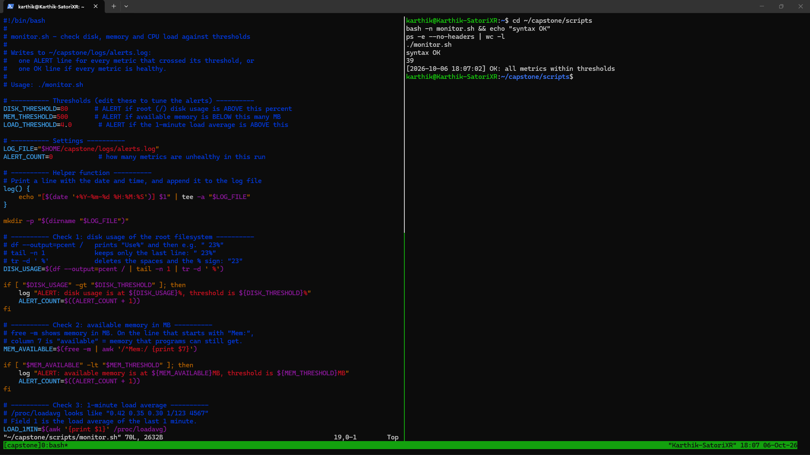

# Linux Capstone: Server Automation

A small server automation setup on Linux: a backup script and a health-monitor script, both scheduled with cron and both writing logs.

**Environment:** Ubuntu 24.04.5 LTS on WSL 2 (kernel `6.6.87.2-microsoft-standard-WSL2`), Windows 11. Time zone: Asia/Kolkata (IST).

## Deliverables

| Deliverable | File |
|---|---|
| Backup script | [`scripts/backup.sh`](scripts/backup.sh) |
| Monitor script | [`scripts/monitor.sh`](scripts/monitor.sh) |
| Backup log (real runs) | [`logs/backup.log`](logs/backup.log) |
| Alerts log (real runs) | [`logs/alerts.log`](logs/alerts.log) |
| Output captured by cron | [`logs/cron.log`](logs/cron.log) |
| `crontab -l` output | [`crontab.txt`](crontab.txt) |
| System report | [`system-report.txt`](system-report.txt) |
| tmux screenshot | [`screenshots/tmux-capstone.png`](screenshots/tmux-capstone.png) |

This repository mirrors the server layout:

```
~/capstone/
├── scripts/    backup.sh, monitor.sh
├── backups/    timestamped .tar.gz archives (not committed)
├── logs/       backup.log, alerts.log, cron.log   (chmod 700: owner only)
└── data/       sample directory that gets backed up (not committed)
```

## `backup.sh`

```bash
./backup.sh <source_directory>
```

- Creates `~/capstone/backups/backup-YYYY-MM-DD-HHMM.tar.gz` from the source directory.
- Appends `[DATE TIME] SUCCESS: archived <source> → <archive>` or `[DATE TIME] ERROR: <reason>` to `logs/backup.log`.
- Deletes archives older than 7 days, but only after a successful backup, so old backups are never removed while new ones are failing.
- Exit codes: `0` success, `1` no argument, `2` source directory missing, `3` tar failed.

## `monitor.sh`

```bash
./monitor.sh
```

| Metric | How it is measured | Alert when |
|---|---|---|
| Root disk usage | `df --output=pcent /` | above `DISK_THRESHOLD=80` % |
| Available memory | `free -m`, "available" column | below `MEM_THRESHOLD=500` MB |
| 1-minute load average | `/proc/loadavg`, field 1 | above `LOAD_THRESHOLD=4.0` |

It writes one `[DATE TIME] ALERT: <metric> is at <value>, threshold is <threshold>` line per crossed threshold, or a single `[DATE TIME] OK: all metrics within thresholds` line when everything is healthy.

## Schedule (cron)

```
0 2 * * *    $HOME/capstone/scripts/backup.sh $HOME/capstone/data/ >> $HOME/capstone/logs/cron.log 2>&1
*/15 * * * * $HOME/capstone/scripts/monitor.sh >> $HOME/capstone/logs/cron.log 2>&1
```

- Backup: daily at 02:00. Monitor: every 15 minutes.
- Output and errors are captured in `cron.log`, so a failure to even start a job is visible.
- Cron runs were verified with log entries written by cron (`18:00:01` monitor, `18:03:01` backup on 2026-10-06) and with `journalctl -u cron`.
- Note: on WSL, cron only runs while the WSL VM is running. On an always-on server the schedule runs 24/7.

## What the logs show

- **`backup.log`**: both error paths (missing argument, missing directory), manual successful backups, and one backup run by cron at 18:03.
- **`alerts.log`**: healthy OK runs, ALERT lines produced by lowering the thresholds as a test, and OK lines written by cron.

## tmux session

A named tmux session `capstone`, with `monitor.sh` open in Vim (left pane) and the script running in the right pane, over SSH (`ssh karthik@localhost`):


